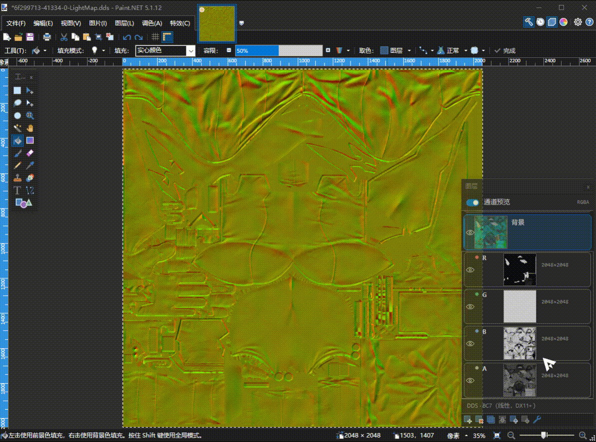
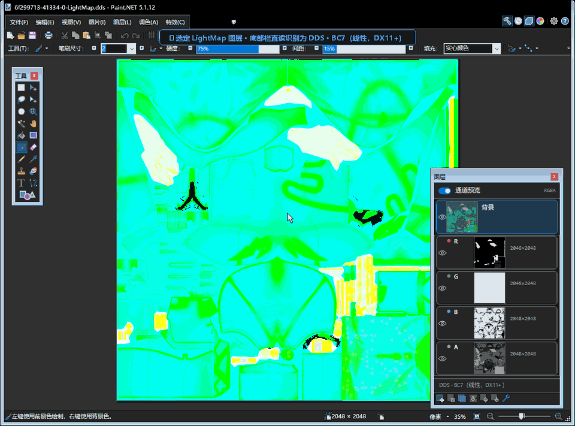
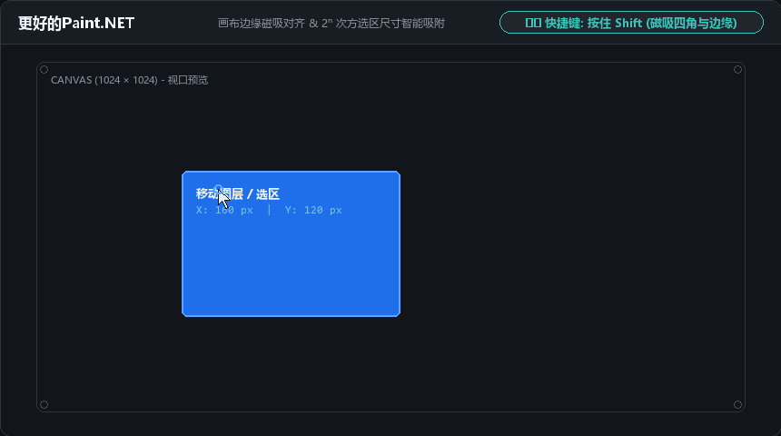

# 更好的 Paint.NET（LayerChannelLive）

给 Paint.NET 增加通道预览与编辑、DDS 格式查看和拖动吸附。功能直接放在图层窗口和移动工具里，方便处理游戏贴图，不用反复拆分、导出通道。

## 安装

在 [Releases](https://github.com/YD-25/LayerChannelLive/releases) 下载文件名含 `InstallPackage` 的 ZIP 安装包并解压，运行 `install.bat`。脚本会关闭 Paint.NET、安装插件，再启动软件；安装前请保存正在编辑的图片。卸载运行 `uninstall.bat`。

已测试：Paint.NET **5.1.12**，Windows 10 / 11 x64。源码编译目标为 `net9.0-windows`。

## 图层与通道

- 选中图层，在下方查看 R、G、B、A 四个通道。
- 点击通道进入单通道视图，使用反色、曲线、滤镜等原生工具编辑；点击图层行返回完整图像。
- 拖动图层或通道调整顺序，切换各自的显示状态；支持撤销与重做。
- 编辑、移动或缩放后，图层缩略图与通道预览同步更新。面板配色跟随软件主题。

## 查看 DDS 格式

底部栏显示当前图层对应源文件的格式，可识别 BC1～BC7、线性 / sRGB、有符号 / 无符号等区别。切换图层后随之更新，悬停可查看文件路径和编码信息。

格式来自源文件头，不是从解码后的像素推测。找不到源文件时显示“格式未知”。

## 拖动吸附

使用移动工具时：

| 操作 | 效果 |
| --- | --- |
| 按住 `Shift` 拖动 | 吸附画布边缘、角落和中线，并显示辅助线 |
| 按住 `Shift` 拖动角点 | 等比缩放，靠近 64、128、256、512、1024 等 `2^n` 像素尺寸时吸附 |
| 按住 `Shift + Alt` 拖动角点 | 以中心点缩放，同时进行尺寸吸附 |

遇到问题请在 [Issues](https://github.com/YD-25/LayerChannelLive/issues) 中说明 Paint.NET 版本、操作步骤，能附上截图或录屏更好。

许可证：[MIT](LICENSE)。
