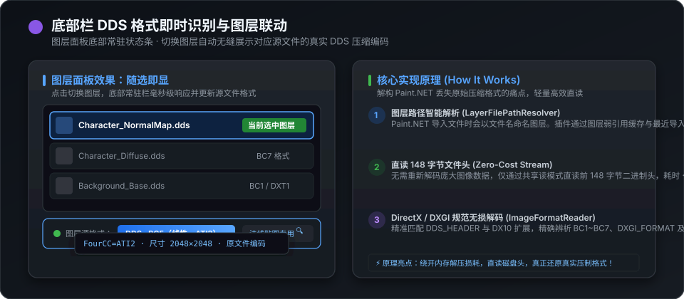

# 更好的Paint.NET (Better Paint.NET)

  
  
  
  

**更好的Paint.NET** 是专为 **Paint.NET 5.1.12** 深度定制的体验增强扩展。无需弹窗与繁琐切换，原生接管图层面板与移动选区，带来三大核心功能：**图层实时通道编辑**、**底部栏 DDS 源格式精准识别** 以及 **画布边缘与选区智能磁吸**。

---

## ⚡ 快速安装与使用

1. 前往 [Releases](https://github.com/YD-25/LayerChannelLive/releases) 下载最新版本的安装包 `LayerChannelLive-v1.0.0-InstallPackage.zip` 并解压。
2. 双击运行 **`install.bat`** 即可自动完成探测、部署并启动 Paint.NET。
3. 打开 Paint.NET 即可直接体验全新的图层通道、DDS 识别与智能吸附功能。
4. 如需卸载，随时双击运行 **`uninstall.bat`**，将安全自动清理相关组件。

---

## 🎨 核心特性一：图层与实时通道深度编辑

深度接管 Paint.NET 原生图层列表，在当前选中图层下方展开直观的 R / G / B / A 四通道视图。

### 1. 原生效果/调整直接作用于通道
- **单通道独立滤镜**：点击任意通道（R/G/B/A）即可进入该通道视图。在 Paint.NET 顶部菜单执行任意原生效果或调整控件（如反色、曲线、色阶、高斯模糊、噪点添加等），效果将**直接精确烘焙到当前所选通道**中。
- **无缝合成与安全撤销**：退出通道回到主图层时自动重组全彩预览；所有通道操作均完整接入宿主历史记录树，支持多次 `Ctrl+Z` / `Ctrl+Y` 无损撤回与重做。

### 2. 通道鼠标拖拽自由互换顺序
- **鼠标拖放秒级置换**：按住任意通道项（如 G 通道或 Alpha 通道）直接拖拽到目标通道项上释放，即可完成通道像素数据的原位对调或重排。
- **游戏贴图打包利器**：在制作 PBR 贴图或 DDS 纹理时，可秒级互换粗糙度、金属度、环境光遮蔽（AO）及 Alpha 透明度通道，免去传统繁琐的通道分离与重复导入流程。

---

## 🔍 核心特性二：底部栏 DDS 格式即时识别与图层联动

图层面板最底部新增常驻状态栏，解决 Paint.NET 导入 DDS 后压缩格式丢失、无法辨别原贴图编码的痛点。

### 1. 随选即变：切换图层自动刷新格式
- **实时显示 DDS 编码**：在图层列表中选中任意 DDS 图层，底部状态栏即刻呈现该图层对应源文件的具体压缩规范（如 `DDS · BC1（线性，DXT1）`、`DDS · BC3（线性，DXT5）`、`DDS · BC5（线性，ATI2 法线）`、`DDS · BC7（线性）`、`DDS · B8G8R8A8（32位未压缩）` 等）。
- **技术详情悬浮提示**：鼠标悬停在底部徽标上，即可通过浮动 ToolTip 查看完整源文件路径、文件大小、FourCC 码以及 DXGI 格式标识。

### 2. 底层原理：如何实现极速精准读取？
传统的 Paint.NET 在导入 DDS 图片时，会把像素解码成内存中的纯 RGBA 位图（Surface），原有的压缩格式与文件头信息在内存对象中已被全部丢弃。本插件采用三步高效机制无损还原真实格式：
1. **图层源文件路径智能逆向解析 (`LayerFilePathResolver`)**：  
   Paint.NET 在导入文件新建图层时，会将图层命名为 `{文件名去掉扩展名}: {原图层名}`。插件通过弱引用哈希缓存（`ConditionalWeakTable`）以及会话期间记录的最近导入文件历史树，毫秒级反向定位图层对应的磁盘源文件路径。
2. **极速直读前 148 字节文件头 (`Zero-Cost Header Stream`)**：  
   插件无需重新解码数十兆甚至上百兆的庞大纹理像素，仅以 `FileShare.ReadWrite` 共享只读流直接抓取文件头部的**前 148 字节**（耗时 `<0.05ms`，零内存损耗，绝不锁死文件）。
3. **DirectX 官方规范精准解码 (`ImageFormatReader`)**：  
   严格依据微软 DirectX 规范解析二进制 `DDS_HEADER`、`DDS_PIXELFORMAT` 及现代 DX10 扩展结构头，精准还原 FourCC 与 `DXGI_FORMAT` 编码，杜绝任何猜测或试探。

---

## 🧲 核心特性三：画布边缘与选区智能磁吸

为移动工具与选区交互注入高精度磁吸对齐能力，告别肉眼像素对齐。

> ### ⌨️ 吸附快捷键说明
> | 快捷键操作 | 适用场景 | 功能说明 |
> |---|---|---|
> | **按住 `Shift` + 拖拽移动** | 移动图层 / 移动选区 | **激活磁性吸附**：自动吸附到画布四个直角、边缘及居中线，显示对齐引导线；松开即锁定坐标 |
> | **按住 `Shift` + 拖拽角点** | 选区缩放 / 变形手柄 | **等比吸附 $2^n$ 次方**：尺寸自动卡位贴靠 64、128、256、512、1024、2048 等标准纹理阶梯 |
> | **按住 `Shift + Alt` + 拖拽角点** | 选区对称缩放 | **以中心点对称缩放**并同时智能吸附 $2^n$ 次方标准尺寸 |
> | **不按任何键（普通拖拽）** | 自由平移与缩放 | 保持 Paint.NET 原生平滑自由拖动行为，完全不打扰正常编辑 |

### 1. 画布四角与边缘磁性吸附
- **快捷键触发**：使用移动工具选中图层或选区后，**按住 `Shift` 键拖动**，靠近画布的四个角落（左上、右上、左下、右下）以及四周边缘时，将自动激活磁吸卡位。
- **高亮辅助线指示**：实时呈现几何吸附参考线与对齐状态提示，确保图层精准归位至边缘或角落坐标（0, 0）；松开 `Shift` 或松开鼠标即可精准提交锁定坐标。

### 2. 拖拽选区角点吸附 $2^n$ 次方纹理尺寸
- **快捷键触发**：选中变形缩放工具后，**按住 `Shift` 键拖拽角点手柄**，长宽尺寸将自动等比对齐并吸附至经典的 $2^n$ 次方阶梯（如 **64、128、256、512、1024、2048** 像素）。
- **中心缩放支持**：配合 **`Alt` 键**（即 `Shift + Alt` 拖拽）可基于中心点对称等比缩放并吸附 $2^n$ 次方。
- **实时尺寸 HUD 反馈**：选区角点浮动展示当前分辨率与二次方匹配状态，贴合游戏引擎与 DDS 贴图规范，杜绝非标准尺寸带来的显存浪费与 Mipmap 缩放模糊。

---

## 💻 兼容性与运行环境

- **支持宿主版本**：**Paint.NET 5.1.12**
- **运行时环境**：.NET 9.0（`net9.0-windows`，与 Paint.NET 5.1.x 内置运行时完全一致）
- **操作系统**：Windows 10 / Windows 11 (x64)

---

## 💬 问题反馈与交流

如果您在使用过程中遇到任何 Bug、异常现象，或有新的功能建议，欢迎随时提交 [GitHub Issues](https://github.com/YD-25/LayerChannelLive/issues)。
