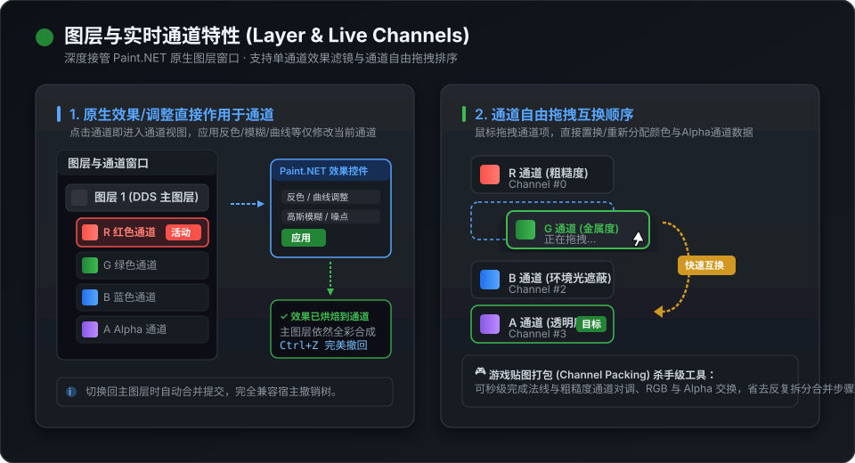
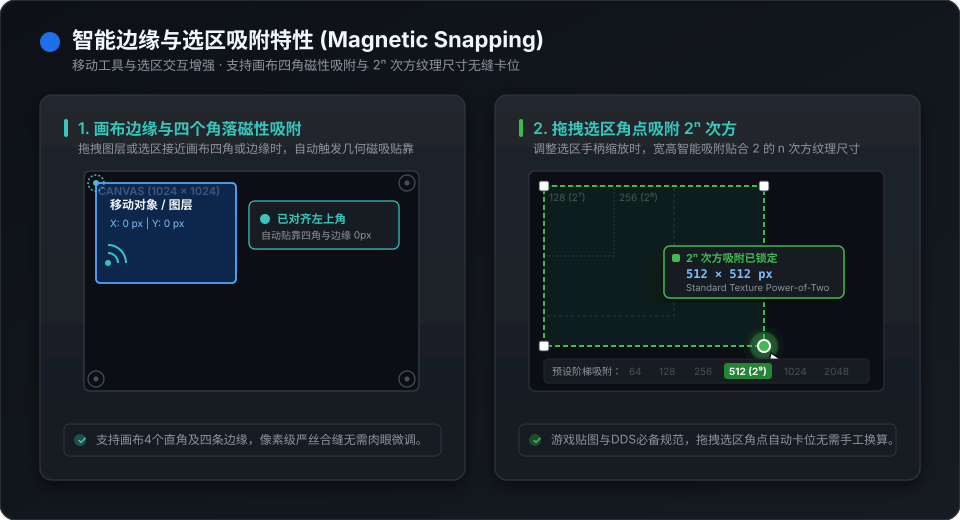

# LayerChannelLive

  
  
  
  

**LayerChannelLive** 是专为 **Paint.NET 5.1.12** 打造的高性能增强扩展。无需弹窗与多余步骤，原生接管图层面板与移动选区，提供**图层通道深度编辑**与**画布边缘智能吸附**两大核心能力。

---

## ⚡ 快速安装与使用

1. 前往 [Releases](https://github.com/YD-25/LayerChannelLive/releases) 下载最新版本的安装包 `LayerChannelLive-v1.0.0-InstallPackage.zip` 并解压。
2. 双击运行 **`install.bat`** 即可自动完成探测、部署并启动 Paint.NET。
3. 打开 Paint.NET 即可直接体验增强的图层通道与吸附功能。
4. 如需卸载，随时双击运行 **`uninstall.bat`**，将安全自动清理相关组件。

---

## 🎨 核心特性一：图层与实时通道深度编辑

深度接管 Paint.NET 原生图层列表，在当前选中图层下方展开直观的 R / G / B / A 四通道视图。

### 1. 原生效果/调整直接作用于通道
- **单通道独立滤镜**：点击任意通道（R/G/B/A）即可进入该通道视图。在 Paint.NET 顶部菜单执行任意原生效果或调整控件（如反色、曲线、色阶、高斯模糊、噪点添加等），效果将**直接精确烘焙到当前所选通道**中。
- **无缝合成与安全撤销**：退出通道回到主图层时自动重组全彩预览；所有通道操作均完整接入宿主历史记录树，支持多次 `Ctrl+Z` / `Ctrl+Y` 无损撤回与重做。

### 2. 通道鼠标拖拽自由互换顺序
- **鼠标拖放秒级置换**：按住任意通道项（如 G 通道或 Alpha 通道）直接拖拽到目标通道项上释放，即可完成通道像素数据的原位对调或重排。
- **游戏贴图打包利器**：在制作 PBR 贴图或 DDS 纹理时，可秒级互换粗糙度、金属度、环境光遮蔽（AO）及 Alpha 透明度通道，免去传统繁琐的通道分离与重复导入流程。

---

## 🧲 核心特性二：画布边缘与选区智能吸附

为移动工具与选区交互注入高精度磁吸对齐能力，告别肉眼像素对齐。

### 1. 画布四角与边缘磁性吸附
- **四角与边界贴靠**：拖拽移动图层或选区靠近画布的四个角落（左上、右上、左下、右下）以及四周边缘时，将自动激活磁吸卡位。
- **高亮辅助线指示**：实时呈现几何吸附参考线与对齐状态提示，确保图层精准归位至边缘或角落坐标（0, 0）。

### 2. 拖拽选区角点吸附 $2^n$ 次方纹理尺寸
- **纹理规范智能阶梯**：使用手柄拖拽缩放选区角点时，尺寸将自动对齐并吸附至经典的 $2^n$ 次方阶梯（如 **64、128、256、512、1024、2048** 像素）。
- **实时尺寸 HUD 反馈**：选区角点浮动展示当前分辨率与二次方匹配状态，贴合游戏引擎与 DDS 贴图规范，杜绝非标准尺寸带来的显存浪费与 Mipmap 缩放模糊。

---

## 💻 兼容性与运行环境

- **支持宿主版本**：**Paint.NET 5.1.12**
- **运行时环境**：.NET 9.0（`net9.0-windows`，与 Paint.NET 5.1.x 内置运行时完全一致）
- **操作系统**：Windows 10 / Windows 11 (x64)

---

## 💬 问题反馈与交流

如果您在使用过程中遇到任何 Bug、异常现象，或有新的功能建议，欢迎随时提交 [GitHub Issues](https://github.com/YD-25/LayerChannelLive/issues)。
